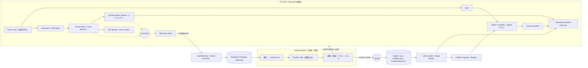
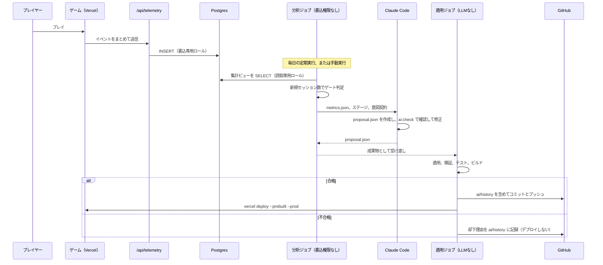

# 02 技術設計：アセット方針・ライブラリ評価・アーキテクチャ・データ構造

[01_review.md](01_review.md) の結論を、実装できる粒度まで具体化したもの。型定義やJSONは設計を示すための抜粋で、実装時に細部は変わりうる。

---

## 5. 3Dモデルの制作方法と Three.js への組み込み

### 5.1 基本方針

建築は「キット」（再利用できるモジュールの部品集）として作り、ステージはキットの部品をグリッド上に並べたデータとして表す。これにより、LLMが配置を変えても見た目の品質が保たれ、検証器はポートの一致という単純な規則で接続を判定できる。制作の順番は、まず単純な形のグレーボックスで遊びを確かめ、遊びが固まってから見た目を作り込む。グレーボックスの段階でもキットの寸法規約は守るので、作り込みは部品の差し替えで済む。

キット部品の基本形（道路、階段、手すり、立方体、塔など）は Blender の Python スクリプトで生成し、細部の造形とUVは手作業で仕上げる。スクリプト化しておくと、寸法の変更や部品の追加を Claude Code が CLI から行えるので、授業テーマの「LLMとクリエイティブツールの連携」の実例にもなる。背景の大量のビルは Blender で作らず、TypeScript 側で手続き的に生成してインスタンス描画する。

### 5.2 グリッドと寸法の規約

| 項目 | 値 | 理由 |
|---|---|---|
| セル（水平） | 4 m × 4 m | 通路として余裕のある幅で、建築ブロックの単位として扱いやすい |
| レベル（垂直） | 4 m | 1層分。階段は1×2セルで1レベル上がる（勾配26.6°） |
| 座標系 | Y上向き、北 = −Z、東 = +X（three.js の慣例） | 変換の混乱を防ぐ |
| プレイヤーのカプセル | 半径0.35 m、全高1.8 m | 一般的な人体寸法 |
| 段差の自動乗り越え | 0.35 m | 階段の蹴上げより大きく、レベル差よりはるかに小さい |
| 登れる最大傾斜 | 40° | 階段（26.6°）と螺旋の回廊（最大約6°）を確実に登れる |
| ジャンプ | 最大高さ1.0 m | 手すり上の不可視ブロッカー（3 m）を越えられない |
| 手すり / 不可視ブロッカー | 1.1 m / 3.0 m | R1（ポート封鎖）を物理的に担保する |
| 通路の最小幅 / 推奨幅 | 2.0 m / 4.0 m | カプセルの直径とカメラの余裕 |
| 天井高の最小値 | 3.0 m（推奨4 m） | 三人称カメラが天井に当たらない |
| 回転体の余白 | 一辺 s の正方断面を中心回転するとき、隣接物が全高にわたる最悪の場合で面から (√2−1)s/2 | 12 m立方体で2.49 m。隙間はポートが一致したときに自動で伸びる渡し板でつなぐ。持ち上げて回す場合は一辺 s 以上持ち上げる必要がある |

### 5.3 Blender での制作規約

1つのモジュールは1つのコレクションにまとめ、原点はモジュールの基準セルの床面中央に置き、寸法はメートル単位でグリッドに揃える。表示用のメッシュとは別に、接続点を `PORT_<方角>_<レベル>`（例：`PORT_N_0`）という名前の Empty で置き、衝突用の簡易形状を `COL_` で始まるメッシュ（箱または凸包）で置く。カメラだけを遮る形状は `CAMCOL_`、近づいたら半透明にしてよいメッシュには `fadeable` というカスタムプロパティを付ける。可動グループの回転軸は `PIVOT` という Empty で示す。これらのカスタムプロパティは glTF の extras として書き出され、three.js では `userData` として読める。

マテリアルはモジュールごとに作らず、建築全体で共有するトリムシート（石、大理石、真鍮、ガラス、コンクリートの帯を1枚にまとめたテクスチャ）に UV を合わせる。これで質感の統一とドローコールの削減を同時に実現する。陰影の焼き込みはモジュール単位のアンビエントオクルージョン（AO）だけにする。可動建築に直接光の影を焼き込むと、動かしたときに影が一緒に動いて破綻するからである。

### 5.4 アセットパイプライン

制作から表示までの流れは次のとおり。Blender 5.2 LTS で作った `.blend` から glTF（`.glb`）を書き出し、リポジトリ内のビルドスクリプト（`tools/assets/build.ts`、glTF Transform の API を使用）にかける。スクリプトは、GLB から `PORT_` と `COL_` の情報を抜き出して `kit/kit.generated.json`（論理と検証が参照するキット定義）を生成し、メッシュには溶接・重複除去・不要データ削除・meshopt 圧縮をかけ、テクスチャは KTX2 に変換する（色は ETC1S、法線は UASTC）。最適化済みのファイルは `public/assets/kit/` に出力される。ゲームは GLTFLoader に MeshoptDecoder と KTX2Loader を組み合わせて読み込み、同じ部品はジオメトリを共有して複製する。

キット定義が GLB から自動生成されるので、「見た目と論理のずれ」が構造的に起きにくい。CIでは、全モジュールについてポートがグリッド上にあること、衝突形状が存在すること、カプセルが歩行セルを通過できること（Rapier をヘッドレスで実行）を検査する。

`.blend` は Git LFS で管理する。テクスチャやHDRIなど外部の素材は、出典・ライセンス・作者を `assets/manifest.json` に記録し、記録のないファイルが `public/assets/` にあればCIを失敗させる。

### 5.5 マテリアル・ライティング・ポストエフェクト

基本は物理ベースのマテリアル（MeshStandardMaterial / MeshPhysicalMaterial）と、CC0 の HDRI から作る環境マップ（PMREM）である。直接光は太陽に相当する平行光源1つで、影は Medium 画質ではプレイヤー周辺に追従する2048²の影マップ1枚、High 画質ではカスケードシャドウ（3分割）にする。ポストエフェクトは pmndrs/postprocessing で、Bloom（ミップマップぼかし）、SMAA、トーンマッピング（AgX または ACES）、ビネットを常用し、AO と被写界深度は High 画質と演出中に限る。トーンマッピングはポストエフェクト側で行い、レンダラー側では無効にする。

独自シェーダーは `src/game/render/shaders/` に集約する。変形の起点から広がるエネルギーの波（距離に応じて発光が伝播する）、ディゾルブ、鏡が割れるような遷移マスク、窓の奥に部屋があるように見せるインテリアマッピング、背景ビルの折り畳みアニメーションがその中身である。ガラスや金属の反射は環境マップとフレネルで表現し、リアルタイムの平面反射は見せ場1か所・半解像度に限る。

画質は Low / Medium / High の3段階とし、さらにフレーム時間に応じて描画解像度を0.6〜1.0倍の範囲で自動調整する。シェーダーのコンパイルによるカクつきを避けるため、読み込み画面の間に `renderer.compileAsync()` で全マテリアルを事前にコンパイルする。

### 5.6 背景都市と大規模演出

背景都市は `visualTheme.backgroundCity.seed` から手続き的に生成する。プレイ領域の外側に同心円状にビルを並べ、高さはノイズで決め、外壁は窓の模様とインテリアマッピングを持つシェーダーで描く。ビルの形は数種類に限り、インスタンス描画（InstancedMesh、種類が多ければ BatchedMesh）で数千棟を少数のドローコールで描く。各インスタンスに回転の蝶番の位置と向き、波が届くまでの遅延を属性として持たせ、シェーダーに時刻と波の発生源を渡すと、都市が波のように折り畳まれる。CPU の負荷はほとんどかからない。

空には都市を上下反転した複製を置き、霧で薄くする。ミラーディメンションのような「頭上にも都市がある」画になるが、同じインスタンスに別の変換をかけるだけなのでコストは小さい。万華鏡のような効果は、終盤の演出中だけ画面を放射状に鏡映するポストエフェクトで行う。

### 5.7 性能予算

基準機は統合GPUのノートPC（例：Apple M1 世代、または Intel Iris Xe 世代）の Chrome 最新版、1920×1080 とする（基準機は要確認）。

| 項目 | Medium（基準機） | High |
|---|---|---|
| 描画解像度 | 1080p × 0.8〜1.0（自動調整） | 1.0 |
| ドローコール | 250以下 | 400以下 |
| 画面内の三角形数 | 150万以下 | 300万以下 |
| テクスチャのGPUメモリ | 256 MB以下 | 512 MB以下 |
| 影 | 2048²を1枚 | カスケード3分割 |
| ポストエフェクト | Bloom、SMAA、トーンマッピング | ＋AO、演出時の被写界深度 |
| フレーム時間（p95） | ゲーム中20 ms以下、演出中33 ms以下 | 16.7 ms以下（単体GPU） |
| 初回ダウンロード | 25 MB以下（Area 2・3 は裏で読み込む） | 同左 |

### 5.8 サウンド

Web Audio API（three.js の AudioListener と PositionalAudio）で、環境音（風、遠くの都市のうなり、合唱のようなパッド）、変形の効果音（開始の機械音、石が擦れるループ、低音のうねり、終わりの金属の共鳴を重ねたもの）、セクションクリアの短い音楽を鳴らす。変形の効果音は対象の建築の位置に定位させ、演出シーケンスの時刻と同期させる。素材は自作、合成、または CC0 / CC BY の素材集から選び、§5.4 の manifest に記録する。ブラウザの自動再生の制限があるので、音はタイトル画面での最初の操作の後に開始する。

### 5.9 ライセンス

第三者の 3D モデル、映像、音声、キャラクター、ロゴは使わない（v0.1 の方針どおり）。テクスチャと HDRI は CC0 を基本とし、フォントは SIL Open Font License のものを使う。CC BY の素材を使う場合は、クレジット画面とリポジトリの両方に表記する。

---

## 6. ライブラリ・開発ツールの評価

版数は 2026-10-27 に npm で確認したもの。実装開始時に版を固定する（`package.json` で範囲指定せず、ロックファイルもコミットする）。

| 領域 | 候補 | 版 | 判定 | 理由 |
|---|---|---|---|---|
| 描画 | three（WebGLRenderer） | 0.186.1 | 採用 | 成熟しており資料が多く、Claude Code の生成精度も高い。0.186 系に固定する |
| 描画 | three（WebGPURenderer＋TSL） | 0.186.1 | Spikeで比較 | 公式の開発の主軸で WebGL2 へのフォールバックもある。一方、メッシュ数の多い場面で CPU 負荷と初回フレームが重いという報告（r183、両バックエンドで同傾向）があり、pmndrs/postprocessing とは併用できない |
| ポストエフェクト | postprocessing（pmndrs） | 6.39.5 | 採用 | WebGL 専用。peer 依存は three >= 0.168 < 0.187 なので、three の更新時に対応を確認する |
| 物理・衝突 | @dimforge/rapier3d-compat | 0.21.0 | 採用 | キャラクターコントローラ、シェイプキャスト、センサーがある。Node でも動くので、CI の通過テストに同じエンジンを使える |
| 衝突（補助） | three-mesh-bvh | 0.9.16 | 必要時のみ | 描画メッシュへのレイキャストを高速化したい場合 |
| ビルド | Vite | 8.3.5 | 採用 | Rolldown に統合された現行版。Node 20.19 以上または 22.12 以上が必要 |
| 言語 | TypeScript | 6.0.3（7.0.2 が最新） | 6.0 を採用 | 7.0（ネイティブ実装）は高速だが、typescript-eslint などの周辺ツールの対応範囲が 6.1 未満に留まっている。VS 後に 7.0 を再評価する |
| Lint・整形 | Biome | 2.6.3 | 採用 | TypeScript の API に依存しない単一ツールで、設定が少ない |
| スキーマ | Zod | 4.6.7 | 採用 | 実行時の検証と JSON Schema の出力を兼ねる。同じスキーマを LLM の構造化出力にも使う |
| 単体テスト | Vitest | 5.0.5 | 採用 | `core`（ソルバー、検証器）のテスト |
| E2E・撮影 | Playwright | 1.64.1 | 採用 | スモークテスト、スクリーンショット比較、動画用のフレームキャプチャ |
| アセット最適化 | @gltf-transform/cli と API | 4.5.1 | 採用 | meshopt、KTX2、不要データ削除 |
| 演出の時間軸 | 自作のシーケンサー | — | 採用 | 固定タイムステップで動かし、リプレイと動画キャプチャで同じ結果を出すため |
| デバッグUI | lil-gui | 0.21.0 | 採用 | 開発ビルドのみで使う軽量なパラメータ調整UI |
| 計測 | stats-gl | 4.2.3 | 採用 | GPU 時間も測れる |
| DB | Supabase（Postgres）と supabase CLI | 2.122.0 | 採用 | マイグレーションを Git で管理する |
| ホスティング | Vercel と vercel CLI | 65.4.0 | 採用 | Functions でテレメトリを受ける。本番デプロイは Actions から CLI で行う |
| LLM 実行 | Claude Code（非対話実行） | 2.1.311 | 採用 | ハーネスで権限を絞って使う（§7.9） |
| LLM 実行（代替） | Claude Agent SDK / Anthropic SDK | 0.3.311 / 1.3.0 | 代替 | 自前でループを組む必要が出た場合 |
| DCC | Blender | 5.2 LTS | 採用 | glTF の書き出しと Python による自動化 |
| ゲームエンジン | Unity / Unreal Engine | — | 本線では不採用 | Three.js に移植できず、時間対効果が低い |

---

## 7. システムアーキテクチャとデータ構造

### 7.1 全体構成



v0.1 の10モジュールとの対応は次のとおり。Rendering System、Player Controller（移動とカメラを分けて Camera System を独立させた）、Transformation System、Collision System、Level Loader、Telemetry System はそのままブラウザ側の構成要素になる。World Graph、Puzzle State Manager、Level Validator の3つは、描画に依存しない純粋な TypeScript のモジュール `core` にまとめた。`core` はブラウザ（ヒント、詰み検出、パー計算）、Node（CI の検証、ステージ用 CLI）、AI パイプライン（提案の事前検査）の三者で共有する。AI Improvement Pipeline は GitHub Actions 上で動く。

### 7.2 リポジトリ構成

```text
src/core/          純粋TS：スキーマ、コンパイル、接続の導出、ソルバー、検証器、指標（three.js と DOM の import を禁止）
src/game/          ブラウザ：render/ world/ player/ puzzle/ fx/ audio/ ui/ telemetry/
api/telemetry.ts   Vercel Function（受信・検証・DB書き込み）
stages/            area1/stage.json など。LLM が変更できるのはここと tunables/ だけ
tunables/          tunables.json（値）。範囲は src/core/tunables.ts（人間が管理）
kit/               kit.generated.json（GLB から生成。手で編集しない）
art/blender/       .blend（Git LFS）と bpy スクリプト
public/assets/     最適化済みの GLB / KTX2 / 音声
tools/             ステージCLI、アセットビルド、AI用スクリプト、動画キャプチャ
ai/                prompts/（プロンプト）、history/（改善履歴）、work/（作業領域・Git管理外）
supabase/          migrations/
tests/             unit/（Vitest）、e2e/（Playwright）
.github/workflows/ ci.yml、improve.yml、deploy.yml、rollback.yml
docs/              設計書
```

`src/core` から three.js や DOM を import していないことは、Biome の import 制限ルールと CI の検査で担保する。

### 7.3 実行時の構成

論理と物理は固定タイムステップ（1/60秒）で更新し、描画は `requestAnimationFrame` ごとに補間して行う。演出のシーケンサーもゲーム内時刻で動くので、入力を記録して再生すれば同じ映像が得られる（動画キャプチャと再現テストに使う）。更新の順番は、入力、プレイヤーの移動（キャラクターコントローラ）、インタラクション（コンソールの検出と Fold Mode）、パズル状態の更新、変形アニメーション、ミラー層の切り替え、カメラ、音、描画の順である。

システム間は型付きのイベントバスで疎結合にする。主なイベントは `puzzle/actionRequested`、`puzzle/stateChanged`、`fold/started`、`fold/finished`、`mirror/shifted`、`player/respawned`、`section/entered`、`section/cleared` で、テレメトリはイベントバスを購読するだけにして、ゲームプレイのコードに送信処理を散らばらせない。

パズル状態は `core` の純粋関数 `applyAction(compiled, state, action)` だけが更新する。描画側は `puzzle/stateChanged` を受けてアニメーションを始め、完了したら `fold/finished` を出して入力ロックを解除する。

### 7.4 ステージデータモデル

v0.1 の想定フィールドとの対応を先に示す。`modules` はそのまま残した。`nodes` と `connections` は廃止し、キット定義のポートから計算で導く（手書きするのは周期リンクなどの `links` だけ）。`transformations` は `groups`（可動グループと状態の定義）に、`interactions` は `interactables` に、`initialState` は各グループの `initial` と `sections` に分けた。`checkpoints`、`goal`、`visualTheme`、`seed` は残した。新たに、パズルの単位を表す `sections`、人間が書く設計意図の `intent`、LLMが変えてよい箇所を示す `slots`、カメラの誘導 `cameraHints`、ヒントの定義 `hints` を加えた。

```ts
// 単位：セル座標は整数（x, z は 4 m、y は 4 m）。回転は 90° 単位の整数。
type Id = string;                       // /^[a-z][a-z0-9_]*$/
type Cell = readonly [x: number, y: number, z: number];
type Side = 'N' | 'E' | 'S' | 'W';
type Quarter = 0 | 1 | 2 | 3;
type L10n = { ja: string; en: string };

interface StageFile {
  schema: 'fold-city/stage@1';
  stageId: Id;                  // 'area1'
  version: string;              // semver。テレメトリに記録する
  kit: string;                  // 'kit@1'
  seed: number;                 // 背景都市と装飾の手続き生成にのみ使う
  title: L10n;
  modules: ModuleInstance[];
  groups: TransformGroup[];
  interactables: Interactable[];
  mirror?: { zones: { id: Id; cells: Cell[] }[] };  // ミラーシフトを使える床
  links?: Link[];               // 周期リンク・ポータル（非ユークリッド接続）
  counters?: { id: Id; modulo: number; initial: number }[];
  sections: PuzzleSection[];
  checkpoints: Checkpoint[];
  goal: Goal;
  cameraHints: CameraHint[];
  hints: HintDef[];
  slots?: VariationSlot[];      // Tier 1 で LLM が選べる可変点（人間が定義）
  visualTheme: VisualTheme;
}

interface ModuleInstance {
  id: Id;
  type: string;                 // キットの型名：'road.straight', 'stair.1x2', 'cube.path3', 'spiral.walkway' …
  at: Cell;                     // 基準セル
  yaw: Quarter;                 // 配置時の向き
  group?: Id;                   // 所属する可動グループ（無ければ静的）
  layer?: 'A' | 'B';            // ミラー層（省略時は両層に存在）
  variant?: string;             // 見た目の差分
  params?: Record<string, unknown>; // パラメトリックな部品の設定（螺旋の a, b, c など）
}

type TransformGroup =
  | { id: Id; kind: 'states';               // 絶対姿勢の有限リスト（最大8）
      pivot: { at: readonly [number, number, number]; axis: 'x' | 'y' | 'z' };
      states: { id: Id; quarterTurns: Quarter; offset?: Cell; label?: L10n }[];
      initial: number; animation: Animation }
  | { id: Id; kind: 'orientation';          // 立方体の回転群（24要素）。操作は相対回転
      pivot: { at: readonly [number, number, number] };
      initial: 'identity'; animation: Animation };

interface Animation { durationMs: number; ease: string; liftCells?: number; sequence?: Id }

interface Interactable {
  id: Id;
  kind: 'console';
  at: Cell; facing: Side;       // 可動しないセルであること（検証器が確認）
  layer?: 'A' | 'B';
  controls: Id;                 // 操作する可動グループ
  operation?: { axis: 'x' | 'y' | 'z' };     // orientation グループの場合の回転軸
  allowedTargets: 'any' | number[];          // Fold Mode で選べる目標
  requires?: Condition;         // 追加条件。物理的な干渉は自動判定なので書かない
  framing?: Id;                 // Fold Mode のカメラ構図（cameraHints の id）
}

type Condition =
  | { all: Condition[] } | { any: Condition[] } | { not: Condition }
  | { groupState: { group: Id; in: number[] } }
  | { counter: { id: Id; eq: number } }
  | { layer: 'A' | 'B' };

interface Link {                // 周期リンク（ペンローズのループ）やポータル
  id: Id; kind: 'periodic' | 'portal';
  from: { at: Cell; side: Side }; to: { at: Cell; side: Side };
  translate?: readonly [number, number, number];   // m 単位。periodic の周期ベクトル
  onCross?: { counter: Id; delta: 1 | -1 };        // 継ぎ目を越えたときのカウンタ変化
}

interface PuzzleSection {
  id: Id; name: L10n;
  groups: Id[]; interactables: Id[];
  startCheckpoint: Id;
  exit: { at: Cell };
  intent: IntentContract;
}

interface IntentContract {      // 人間が書く。LLM は変更できない
  teaches: string[];            // 'fold.roll', 'fold.yaw', 'interference' …
  optimalActions: { min: number; max: number };
  mustUse: Id[];                // 全ての最短解で使われるべきコンソールやギミック
  maxDeadEndStates: 0;
  targets?: { clearRate?: [number, number]; medianSec?: [number, number] };
}

interface Checkpoint { id: Id; at: Cell; facing: Side; section: Id }
interface Goal { at: Cell; sequence?: Id }
interface CameraHint {
  id: Id; volume: { min: Cell; max: Cell };
  mode: 'bias' | 'lock';        // lock はペンローズの展望台など
  yawDeg?: number; pitchDeg?: number; distance?: number; fovDeg?: number;
  lookAt?: readonly [number, number, number]; blendMs?: number; priority?: number;
}
interface HintDef {
  id: Id; section: Id; tier: 1 | 2 | 3;
  type: 'pulse-next-console' | 'ghost-path' | 'caption';   // 次の一手はソルバーが計算する
  text?: L10n;
}
interface VariationSlot {
  id: Id;
  kind: 'interactablePlacement' | 'checkpointPlacement' | 'cameraHint' | 'groupInitial' | 'counterTarget' | 'moduleVariant';
  target: Id;
  options: unknown[];           // 人間が見た目と検証を済ませた候補
  current: number;
}
interface VisualTheme {
  palette: Id; timeOfDay: number;
  fog: { color: string; density: number };
  backgroundCity: { seed: number; density: number; foldWaves: number };
}
```

ヒントの表示時刻、誘導の強さ、移動速度などの数値は `tunables/tunables.json` に置き、その範囲は `src/core/tunables.ts` の Zod スキーマで定める。範囲は人間が管理し、LLM は範囲の中で値だけを変えられる。

```ts
export const Tunables = z.object({
  player: z.object({ walkSpeed: z.number().min(4).max(6), dashMultiplier: z.number().min(1.3).max(1.8) }),
  hints: z.record(z.string(), z.object({
    tier1AfterSec: z.number().min(20).max(240),
    tier2AfterSec: z.number().min(40).max(360),
  })),
  guidance: z.record(z.string(), z.object({ beaconIntensity: z.number().min(0).max(1) })),
  camera: z.record(z.string(), z.object({
    yawDeg: z.number().min(-180).max(180),
    pitchDeg: z.number().min(-10).max(45),
    distance: z.number().min(4).max(14),
  }).partial()),
});
```

### 7.5 ステージデータの例（Area 1-2 パスキューブの抜粋）

```json
{
  "schema": "fold-city/stage@1",
  "stageId": "area1",
  "version": "1.0.0",
  "kit": "kit@1",
  "seed": 1207,
  "title": { "ja": "折り目", "en": "The Fold" },
  "modules": [
    { "id": "w_road_1", "type": "road.straight", "at": [-4, 3, 0], "yaw": 1 },
    { "id": "w_road_2", "type": "road.end.plate", "at": [-3, 3, 0], "yaw": 1 },
    { "id": "n_balcony", "type": "balcony.plate", "at": [0, 3, -3], "yaw": 0 },
    { "id": "s_balcony", "type": "balcony.plate", "at": [0, 3, 3], "yaw": 2, "variant": "mural_cube_faces" },
    { "id": "e_road_1", "type": "road.end.plate", "at": [3, 3, 0], "yaw": 3 },
    { "id": "cube", "type": "cube.path3", "at": [-1, 0, -1], "yaw": 0, "group": "g_cube",
      "params": { "faces": { "top": "straight@0", "north": "corner@1", "bottom": "tee@0",
                             "south": "corner@2", "east": "straight@1", "west": "straight@0" } } }
  ],
  "groups": [
    { "id": "g_cube", "kind": "orientation", "pivot": { "at": [0.5, 1.5, 0.5] }, "initial": "identity",
      "animation": { "durationMs": 2200, "ease": "inOutCubic", "sequence": "seq_cube_turn" } }
  ],
  "interactables": [
    { "id": "c_roll", "kind": "console", "at": [-3, 3, 0], "facing": "E", "controls": "g_cube",
      "operation": { "axis": "x" }, "allowedTargets": "any", "framing": "cam_cube" },
    { "id": "c_yaw", "kind": "console", "at": [0, 3, -3], "facing": "S", "controls": "g_cube",
      "operation": { "axis": "y" }, "allowedTargets": "any", "framing": "cam_cube" }
  ],
  "sections": [
    { "id": "area1_cube", "name": { "ja": "パスキューブ", "en": "The Path Cube" },
      "groups": ["g_cube"], "interactables": ["c_roll", "c_yaw"],
      "startCheckpoint": "cp_cube", "exit": { "at": [3, 3, 0] },
      "intent": { "teaches": ["fold.roll", "fold.yaw", "console-position-matters"],
                  "optimalActions": { "min": 2, "max": 3 },
                  "mustUse": ["c_roll", "c_yaw"], "maxDeadEndStates": 0,
                  "targets": { "clearRate": [0.85, 1.0], "medianSec": [40, 110] } } }
  ],
  "slots": [
    { "id": "slot_yaw_console", "kind": "interactablePlacement", "target": "c_yaw",
      "options": [ { "at": [0, 3, -3], "facing": "S" }, { "at": [1, 3, -3], "facing": "W" } ], "current": 0 }
  ]
}
```

立方体（一辺12 m、3×3×3セル）の周囲には1セル（4 m）の隙間を空けている。立方体を垂直軸まわりに回すと角が面から2.49 mまで掃引するので、隣接する道路やバルコニーを面に密着させることはできない。`*.plate` 型の部品は、向かい合うポートが一致したときに自動で伸びる渡し板を持ち、変形の開始時に引っ込み、完了時に一致した側だけ伸びる。渡し板が伸びている側が「つながっている側」なので、接続状態がひと目で分かるという利点もある。

### 7.6 コンパイル、接続の導出、ソルバー

ステージは、実行前に `core` の `compileStage(stage, kit)` で、実行時と検証で使う内部表現に変換する。コンパイラはまず各モジュールの定義をキットから解決し、可動グループの状態ごとにモジュールの世界座標での姿勢を求める。次に、姿勢を変換した後の床面の法線が上向きのセルだけを歩行セルとして残し（立方体なら上を向いた面の道だけが歩ける）、ポートも水平なものだけを残す。2つのポートは、同じセル境界に向かい合って位置し、床の高さが一致したときに接続される。接続されたセルを Union-Find で束ねたものが「領域」で、プレイヤーの位置は領域単位で扱う。状態の組み合わせは全て列挙せず、必要になった状態だけを計算してメモ化する。干渉の判定では、遷移の途中の角度（例えば15度刻み）でモジュールの占有セルを計算し、他のモジュールと重なるかを調べる。

探索の状態は「プレイヤーのいる領域」と「パズル状態」（各グループの状態、ミラー層、カウンタ）の組である。領域の中の移動は手数0、コンソールの操作は手数1として 0-1 BFS を行うと、最短手数と手順が求まる。逆向きの到達可能性を調べれば、ゴールに到達できない状態（詰み状態）も列挙できる。Area 1 の各セクションでは状態数が数十程度なので、ブラウザでも1ミリ秒未満で計算でき、実行時のヒント（次に使うべきコンソールを光らせる）、詰みの検出、パーの表示にそのまま使える。

```ts
export function compileStage(stage: StageFile, kit: KitManifest): CompiledStage;
export function solve(cs: CompiledStage, from: SearchNode, goal: GoalSpec): {
  optimalActions: number; plan: PlannedAction[]; explored: number;
  deadEnds: SearchNode[]; firstMovePenalty: Record<string, number>;
};
export function validateStage(stage: StageFile, kit: KitManifest): ValidationReport; // errors / warnings / metrics
```

### 7.7 検証器のルール

| ID | 分類 | ルール | 扱い |
|---|---|---|---|
| S1 | 構造 | Zod スキーマに適合する | エラー |
| S2 | 構造 | ID が一意で、全ての参照（group、controls、section、slot の target）が解決できる | エラー |
| S3 | 構造 | モジュールの型がキットに存在し、パラメータがキットの定める範囲内にある | エラー |
| G1 | 幾何 | 到達可能な全状態で、モジュールの占有セルが重ならない | エラー |
| G2 | 幾何 | コンソール、ミラー領域、チェックポイントが可動しない歩行セルにある | エラー |
| G3 | 幾何 | 許可された遷移の掃引領域がアンカーセルと交差しない。他のモジュールとの交差は「干渉」としてその遷移を禁止する | エラー / 自動計算 |
| G4 | 幾何 | 接続されたポート同士で床の高さが一致し、天井高3 m以上、通路幅2 m以上を満たす | エラー |
| G5 | 幾何 | 歩行セルの全ての境界が、一致したポート、封鎖、明示的なドロップポートのいずれかである | エラー |
| G6 | 幾何 | 周期リンクの両端で幾何が周期ベクトルだけずれて一致する | エラー |
| G7 | 幾何 | ミラー領域のセルが両方の層で歩行可能で、どちらの層でもプレイヤーの体積が他の形状と重ならない | エラー |
| L1 | 論理 | 各セクションが開始チェックポイントと初期状態から解ける。ゲーム全体もスタートから解ける | エラー |
| L2 | 論理 | 最短手数が意図契約の帯に入る | エラー |
| L3 | 論理 | 到達可能な状態のうち、ゴールに到達できない状態が0（リセットを除く） | エラー |
| L4 | 論理 | 全ての最短解が `mustUse` のギミックを使う（意図したギミックを迂回できない） | エラー |
| L5 | 論理 | どの到達可能状態でも使えないコンソールがない | 警告 |
| L6 | 論理 | セクションのリセットが、解ける状態に戻す | エラー |
| P1 | 物理（CI） | ヘッドレスの Rapier で、最短解の経路をカプセルが歩き切れる（Phase 2 から） | エラー |
| P2 | 物理（CI） | キットの全モジュールの歩行セルをカプセルが通過できる（キット更新時） | エラー |
| Q1 | 品質 | セクションごとの三角形数とドローコールの見積もりが予算内 | 警告 |
| Q2 | 品質 | 全セクションにカメラヒントとヒント定義がある | 警告 |
| Q3 | 品質 | tunables が範囲内にある | エラー |
| A1 | AI | 提案の操作が許可リストにあり、件数の上限を守り、根拠として挙げた指標のパスが metrics.json に実在する | エラー |
| A2 | AI | 変更されたファイルが `stages/`、`tunables/`、`ai/history/` に限られる | エラー |

### 7.8 テレメトリ

**送るイベント**は次のとおり。全てのイベントにセッション内の連番と、セッション開始からの経過ミリ秒が付く。

| type | 主な内容 | 送る頻度 |
|---|---|---|
| `session_start` | ビルドID、各ステージの版、画質、粗い環境情報（GPU段階、ブラウザ種別、OS種別、言語、画面サイズの区分） | 開始時 |
| `section_enter` / `section_clear` | セクションID。クリア時は所要時間、使った手数、最短手数、ヒント回数、リセット回数 | 都度 |
| `action` | コンソール、グループ、変更前後の状態、プレイヤーのセル、成否と失敗理由（干渉した物） | 都度 |
| `fold_preview` | Fold Mode で見た目標状態（確定しなかったものも含む） | 都度（間引きあり） |
| `mirror_shift` / `lap` | 層の切り替え、周回カウンタの増減 | 都度 |
| `reset` / `respawn` | 理由（手動、詰み検出による提案）、位置 | 都度 |
| `hint_shown` | ヒントID と段階 | 都度 |
| `pos` | 2秒ごとのセルキーの列（連続する重複は除く） | まとめて |
| `perf` | フレーム時間の p50 / p95、描画解像度の倍率、画質 | 30秒ごと |
| `feedback` | 面白さ・難しさ・分かりやすさ（各1〜5）、詰まった場所（選択式）、任意の短文（200字まで） | クリア時・離脱時 |
| `session_end` | 理由（クリア、ページ離脱、放置）、最後のセクションとセル | 終了時 |

**送信方法**：イベントはメモリにためて、15秒ごと、セクションが変わったとき、ページを離れるとき（`pagehide`）に `navigator.sendBeacon` で `/api/telemetry` に送る。1回の送信は64 KB以下にする。タイトル画面で収集内容を告知し、送信を止める設定を用意する。ブラウザが Global Privacy Control または Do Not Track を示している場合は、既定で送信しない。

**受信側**：Vercel Function はスキーマ検証、セッションあたりのイベント数の上限、時刻の妥当性の確認を行い、Postgres に書き込む。IPアドレスは保存しない。Supabase の Data API は使わず、`telemetry` スキーマに対して INSERT だけを許したロールで、接続プーラー（トランザクションモード）経由で書き込む。読み出しは集計ビューへの SELECT だけを許した別のロールで、GitHub Actions から行う。

```sql
create schema telemetry;

create table telemetry.sessions (
  id uuid primary key,
  started_at timestamptz not null default now(),
  build text not null,
  stage_versions jsonb not null,
  client jsonb not null               -- 粗い分類だけを入れる
);

create table telemetry.events (
  id bigint generated always as identity primary key,
  session_id uuid not null references telemetry.sessions(id) on delete cascade,
  seq int not null,
  t_ms int not null,
  type text not null,
  section text,
  data jsonb not null default '{}',
  received_at timestamptz not null default now(),
  unique (session_id, seq)
);
create index on telemetry.events (type, section);

-- 集計ビュー：v_section_funnel, v_section_actions, v_first_moves, v_stuck_cells, v_feedback, v_perf
create role telemetry_writer login;   -- パスワードは Vercel の環境変数にだけ置く
grant usage on schema telemetry to telemetry_writer;
grant insert on telemetry.sessions, telemetry.events to telemetry_writer;
create role telemetry_reader login;   -- GitHub Actions の secret にだけ置く
grant usage on schema telemetry to telemetry_reader;
-- 集計ビューを作成した後に、ビューへの SELECT だけを telemetry_reader に付与する
```

生のイベントは授業の終了後（または180日後）に削除し、集計結果だけを残す。

**分析指標**：v0.1 の分析指標は次のように計算する。クリア率は `section_enter` に対する `section_clear` の割合で、Wilson の95%信頼区間を併記する。クリア時間は平均ではなく中央値と75パーセンタイルにする（放置による外れ値に強い）。エリア別の離脱率は `session_end` の最後のセクションから求める。変形操作の回数とリトライ率は `action` と `reset` から求める。「パズルの最適解からの乖離」は、クリアまでに使った手数とソルバーの最短手数の差で表す。さらに、初手の分布（どのコンソールでどの状態を選んだか）を集計すると、「多くの人が最初に誤った方向へ転がしている」といった誘導の問題を特定できる。主観評価は `feedback` の数値を使い、自由記述は §7.9 の隔離した分類器でラベルに変換してから扱う。

### 7.9 AI改善パイプライン

#### ハーネスの設計

パイプラインは「分析ジョブ」と「適用ジョブ」の2つに分ける。分析ジョブにはリポジトリへの書き込み権限を与えず、LLM はここでだけ動く。適用ジョブは LLM を一切使わず、決定的なコードだけで動き、書き込み権限とデプロイの権限を持つ。こうすると、LLM が何を出力しても、検証器を通らない変更がコミットされることはなく、LLM の実行環境にデプロイ用の認証情報が存在することもない。

分析ジョブでは、まず集計スクリプトが読み出し専用ロールで Postgres の集計ビューを読み、ソルバーの静的指標と合わせて `metrics.json` を作る。前回の実行から新しいセッションが一定数（初期値8）に満たなければ、LLM を呼ばずに終了する（費用の節約と、ノイズへの過剰反応の防止）。次に、プレイヤーの自由記述を、ツールを一切持たない別の LLM 呼び出しで「カメラが分かりにくい」「次に何をすべきか不明」などの決まったラベルに分類する。改善提案を作るエージェントは、生の自由記述を見ず、ラベルの集計だけを受け取る。指示文が紛れ込んだ自由記述があっても、エージェントには届かない。

提案を作るエージェントは Claude Code の非対話実行で、読み取りと `ai/work/proposal.json` への書き込み、検証コマンド `npm run ai:check` の実行だけを許可する。エージェントは提案を書き、検証コマンドで適用結果（ソルバーの指標と検証器の結果）を確かめ、必要なら書き直す。これが授業テーマのループエンジニアリングにあたる部分である。最大ターン数と費用の上限を設定し、超えたら提案なしで終了する。分析ジョブは `proposal.json` と実行記録を成果物として残す。

適用ジョブは成果物を受け取り、決定的な適用スクリプトで `stages/` と `tunables/` を書き換え、検証器、単体テスト、ビルドを実行する。全て合格したときだけ、仮説と根拠と変更内容を書いた改善記録を `ai/history/` に追加し、コミットとプッシュを行い、本番にデプロイする。不合格の場合は、却下の理由を改善記録に残すだけで、デプロイはしない。



#### LLM に渡すものと、LLM が返すもの

LLM に渡す `metrics.json` は、集計済みの数値だけで構成する（抜粋）。

```json
{
  "window": { "from": "2026-12-07", "to": "2026-12-13", "newSessions": 23 },
  "build": "a1b2c3d",
  "sections": {
    "area1_cube": {
      "entered": 23, "cleared": 17, "clearRate": { "value": 0.74, "ci95": [0.54, 0.87] },
      "timeSec": { "median": 128, "p75": 201 },
      "actions": { "median": 5, "optimal": 2 },
      "firstMoves": [ { "label": "c_roll:x180", "share": 0.48 }, { "label": "c_roll:x90", "share": 0.35 } ],
      "stuckCells": [ { "cell": "-2,3,0", "dwellSecTotal": 1460, "sessions": 14 } ],
      "hints": { "tier1": 11, "tier2": 4 }, "resets": 6, "quitHere": 3
    }
  },
  "feedbackLabels": { "camera_confusing": 3, "unclear_next_step": 6, "loved_fold": 9 },
  "solver": { "area1_cube": { "optimalActions": 2, "states": 10, "deadEnds": 0 } },
  "history": [ { "id": "exp-2026-12-06-01", "ops": ["setTunable hints.area1_cube.tier1AfterSec 60"], "status": "evaluating" } ]
}
```

LLM が返す `proposal.json` は、仮説、根拠（`metrics.json` のパス）、操作の列、期待する効果で構成する。根拠のパスが実在しない提案は、検証器 A1 で却下される。仮説の確信度が低い場合は Tier 0 の操作しか許されない。データが不十分なときに「変更しない」と返すことも正しい出力として扱う。

```json
{
  "schema": "fold-city/proposal@1",
  "basedOn": { "build": "a1b2c3d", "window": ["2026-12-07", "2026-12-13"] },
  "summary": { "ja": "立方体の初手で180度転がす人が多く、西の道路で長く迷っている。北のバルコニーへ行けることが見えていない可能性が高い。", "en": "..." },
  "hypotheses": [
    { "id": "H1", "section": "area1_cube",
      "problem": "北のバルコニーへ渡れる状態が、西から見えにくい",
      "evidence": ["sections.area1_cube.firstMoves", "sections.area1_cube.stuckCells", "feedbackLabels.unclear_next_step"],
      "confidence": "medium" }
  ],
  "ops": [
    { "op": "chooseSlotOption", "slot": "slot_yaw_console", "option": 1, "why": "H1" },
    { "op": "setTunable", "path": "guidance.area1_cube.beaconIntensity", "value": 0.7, "why": "H1" }
  ],
  "expected": [ { "metric": "sections.area1_cube.timeSec.median", "direction": "down" } ],
  "noChange": false
}
```

#### ガードレール

1回の実行で許す操作は最大3件、そのうち Tier 1（スロットの選択）はセクションあたり最大1件とする。Tier 1 の操作は、そのセクションのセッション数が10以上のときだけ許す。同じスロットや同じパラメータは、2回の実行の間は再変更を禁止する（評価する前に変えて振動するのを防ぐ）。変更後の評価期間でクリア率が信頼区間を考慮しても15ポイント以上下がった場合は、自動的に元に戻す提案を作る。本番へのデプロイは1日1回までとする。全ての変更は意図契約（最短手数の帯、必須ギミック）を満たさなければならない。リポジトリ変数 `AI_LOOP_MODE` を `off`（停止）、`pr`（PRを作るだけ）、`auto`（自動適用）で切り替えられるようにし、授業の発表直前などに止められるようにする。

#### 実行方式と費用の見込み

エージェントは Claude Code の非対話実行（`claude -p`）を GitHub Actions のステップで動かす。モデルはリポジトリ変数 `CLAUDE_MODEL` で指定し、既定は Claude Opus 5.5、費用を抑えたい場合は Claude Sonnet 5.5 に切り替える（モデル ID は設定時に公式の一覧で確認して変数に入れる）。自由記述の分類はツールを持たない単発の API 呼び出しで、同じモデル（低い effort）または Claude Haiku 5.5 を使う。料金（2026-10-06 時点、100万トークンあたり）は Opus 5.5 が入力4ドル・出力20ドル（キャッシュ読み取り0.2ドル）、Sonnet 5.5 が入力2ドル・出力10ドル、Haiku 5.5 が入力0.1ドル・出力0.5ドルである。エージェントが10〜15ターン動き、各ターンの入力が4〜6万トークン（大半はキャッシュに乗る）、出力が合計2万トークン程度だとすると、Opus 5.5 で1回あたり概算0.5〜1.5ドルになる。毎日動かしても、ゲートにより実際に LLM を呼ぶのは月10〜20回程度と見込まれ、月10〜30ドル程度に収まる。上限は三重に掛ける。Anthropic Console のワークスペースに月額の利用上限を設定し、Claude Code 側では最大ターン数と1回あたりの費用上限（`--max-budget-usd`、クライアント側の見積もりなので超えることがある）を指定し、さらに実行結果の JSON に含まれる `total_cost_usd` を改善記録に残して、その月の累計が予算を超えたらゲートが LLM を呼ばないようにする。

認証、権限指定の構文、出力形式の詳細は §7.11 にまとめた。

### 7.10 デプロイ、ロールバック、秘密情報

本番デプロイの経路は GitHub Actions に一本化する。Vercel の Git 連携は、プレビュー用（main 以外のブランチ）にだけ使い、`vercel.json` の `git.deploymentEnabled` で main の自動デプロイを止める。人が main にプッシュしたときは `deploy.yml` が、AI の適用ジョブがプッシュしたときは適用ジョブ自身が、`vercel build --prod` と `vercel deploy --prebuilt --prod` を所有者のトークンで実行する（`GITHUB_TOKEN` によるプッシュは他のワークフローを起動しないので、適用ジョブの中でデプロイまで行う）。これで Hobby プランのコミット作成者の制限を避けられる。この経路が実際に通ることは Walking Skeleton で最初に確認する。

デプロイに成功するたびに `stable-YYYYMMDD-N` のタグを付け、`rollback.yml` を手動実行すると指定したタグの内容を再デプロイできるようにする。ゲームのビルドにはコミットのハッシュとステージの版を埋め込み、テレメトリと改善記録の両方から、どの版で何が起きたかを辿れるようにする。

| 秘密情報 | 置き場所 | 使うジョブ・処理 | 権限 |
|---|---|---|---|
| `ANTHROPIC_API_KEY` | GitHub Actions の secret | 分析ジョブの LLM ステップのみ | 利用上限を設定したワークスペースのキー |
| `TELEMETRY_DB_READER_URL` | GitHub Actions の secret | 分析ジョブの集計ステップのみ | 集計ビューへの SELECT のみ |
| `TELEMETRY_DB_WRITER_URL` | Vercel の環境変数（サーバー側） | `/api/telemetry` | telemetry スキーマへの INSERT のみ |
| `VERCEL_TOKEN`、`VERCEL_ORG_ID`、`VERCEL_PROJECT_ID` | GitHub Actions の secret | 適用ジョブ、`deploy.yml`、`rollback.yml` | デプロイ |

秘密情報はステップ単位の環境変数として渡し、ジョブ全体には渡さない。ビルド成果物に秘密情報の形（`sk-ant-`、`postgres://`、`sb_secret_` など）が含まれていないことを CI で検査する。

### 7.11 Claude Code の非対話実行の詳細

Claude Code の公式ドキュメント（2026-10-27 時点）で確認した事項と、それを踏まえた設定方針をまとめる。

**Action ではなく CLI を直接使う。** `anthropics/claude-code-action@v1` は `prompt` 入力を渡すと自動モードで動き、定期実行の例も公式にある。CLI のオプションは `claude_args` 入力で渡す（v1 では `allowed_tools`、`max_turns`、`model` は独立した入力ではない）。ただし、自動モードでのコミットとプッシュの挙動は文書化されておらず、プッシュを止める入力も見当たらない。本設計では「エージェントはプッシュしない」ことを構造で保証したいので、ワークフローのステップで `claude -p` を直接実行する。

**認証は API キーを推奨する。** CI では `ANTHROPIC_API_KEY` のほかに、Pro / Max などのサブスクリプションで `claude setup-token` を実行して得る1年有効の `CLAUDE_CODE_OAUTH_TOKEN` も使え、ドキュメントでも CI やスクリプト向けとして案内されている。一方で、OAuth は通常の利用を想定したもので、Pro / Max の利用枠は個人の通常利用を前提にしている、とも書かれている。毎日無人で動き、公開中のゲームが依存するジョブには、利用上限を設定できる API キーが適している。ユーザー本人による短期の試験に限ってサブスクリプションのトークンを使うことは考えられるが、最終判断はユーザーに委ねる（利用条件の解釈についての法的な助言ではない）。なお、両方が設定されていると API キーが優先される。

**設定を読み込まない最小構成で起動する。** `--bare` を付けると、リポジトリ内のフック、スキル、CLAUDE.md、MCP の設定を読み込まない。何も付けずに `-p` で実行すると、プロジェクトのフックや `.mcp.json` のサーバーが確認なしに動くので、ハーネスの外から挙動を変えられる余地を残してしまう。`--bare` は OAuth トークンを使えず API キーが必要になる点でも、上の認証方針と一致する。

**権限の指定で注意すべき点。** 評価の順番は拒否、確認、許可で、許可のルールで拒否のルールに例外を作ることはできない。作業ディレクトリ内の読み取りにはルールが要らない。ファイル書き込みの制限は `Edit(...)` で書く。`Edit(...)` のルールは Write、MultiEdit、NotebookEdit にも適用されるが、`Write(...)` と書いたルールは受け付けられるのに一致しないので、気づかないまま無効になる。Bash のルールは `Bash(npm run ai:check)` と書くと完全一致になり、引数を許すなら `Bash(npm run ai:check *)` とする（`*` の前の空白に意味がある）。`&&` などでつないだコマンドは分割され、それぞれがルールに一致しなければならないので、許可したコマンドの後ろに `curl` をつなぐことはできない。ただし、許可したスクリプトがサブプロセスとして行うことは制限されないので、`ai:check` は提案ファイルを JSON として検証するだけで、その内容をコードとして実行しないように作る。さらに強く縛る場合は Claude Code のサンドボックスを使う。`--permission-mode dontAsk` を指定すると、確認が必要になる操作は全て拒否され、許可のルールに一致した操作だけが実行される。

**出力と上限。** `--output-format json` の結果には `result`、`session_id`、`total_cost_usd`（モデル別の内訳つき）、`usage` が含まれ、`--json-schema` を併用すると、スキーマに合う出力が得られた場合だけ `structured_output` が付く。`--max-turns` は上限に達するとエラーで終了する。

**ワークフローの骨子**（フラグの細かな書式は Walking Skeleton で実機確認する）：

```yaml
name: improve
on:
  schedule:
    - cron: "17 18 * * *"        # 毎日 03:17 JST（定時ちょうどを避ける）
  workflow_dispatch:
concurrency: { group: improve, cancel-in-progress: false }
permissions: { contents: read }

jobs:
  analyze:                        # LLM はこのジョブだけで動く。書き込み権限なし
    if: vars.AI_LOOP_MODE != 'off'
    runs-on: ubuntu-latest
    timeout-minutes: 30
    outputs: { run: "${{ steps.gate.outputs.run }}" }
    steps:
      - uses: actions/checkout@v5
      - uses: actions/setup-node@v5
        with: { node-version: 22, cache: npm }
      - run: npm ci
      - name: 集計（読み取り専用ロール）
        run: npm run ai:metrics -- --out ai/work/metrics.json
        env: { TELEMETRY_DB_READER_URL: "${{ secrets.TELEMETRY_DB_READER_URL }}" }
      - id: gate                  # 新規セッション数と今月の累計費用で判定
        run: npm run ai:gate -- ai/work/metrics.json >> "$GITHUB_OUTPUT"
      - name: 自由記述の分類（ツールなしの単発呼び出し）
        if: steps.gate.outputs.run == 'true'
        run: npm run ai:classify -- ai/work/metrics.json
        env: { ANTHROPIC_API_KEY: "${{ secrets.ANTHROPIC_API_KEY }}" }
      - name: 提案の作成（Claude Code）
        if: steps.gate.outputs.run == 'true'
        run: >
          npx --no-install claude -p "$(cat ai/prompts/improve.md)"
          --bare --model "${{ vars.CLAUDE_MODEL }}" --permission-mode dontAsk
          --disallowedTools WebFetch WebSearch
          --allowedTools "Edit(ai/work/proposal.json)" "Bash(npm run ai:check)"
          --max-turns 15 --max-budget-usd 2
          --output-format json --json-schema "$(cat ai/schemas/run-summary.json)"
          > ai/work/run.json
        env: { ANTHROPIC_API_KEY: "${{ secrets.ANTHROPIC_API_KEY }}" }
      - uses: actions/upload-artifact@v4
        with: { name: proposal, path: ai/work/ }

  apply:                          # LLM を使わない。書き込みとデプロイの権限を持つ
    needs: analyze
    if: needs.analyze.outputs.run == 'true'
    runs-on: ubuntu-latest
    permissions: { contents: write, pull-requests: write }
    steps:
      - uses: actions/checkout@v5
      - uses: actions/setup-node@v5
        with: { node-version: 22, cache: npm }
      - run: npm ci
      - uses: actions/download-artifact@v4
        with: { name: proposal, path: ai/work/ }
      - run: npm run ai:apply -- ai/work/proposal.json     # 規則 A1・A2 を強制し、ai/history に記録
      - run: npm run validate:stages && npm test && npm run build
      - run: npm run ai:commit                             # auto なら main へプッシュ、pr なら PR を作成
      - name: 本番デプロイ（auto のときのみ）
        if: vars.AI_LOOP_MODE == 'auto'
        run: |
          npx vercel pull --yes --environment=production --token="$VERCEL_TOKEN"
          npx vercel build --prod --token="$VERCEL_TOKEN"
          npx vercel deploy --prebuilt --prod --token="$VERCEL_TOKEN"
        env:
          VERCEL_TOKEN: "${{ secrets.VERCEL_TOKEN }}"
          VERCEL_ORG_ID: "${{ secrets.VERCEL_ORG_ID }}"
          VERCEL_PROJECT_ID: "${{ secrets.VERCEL_PROJECT_ID }}"
```

Claude Code はバージョンを固定した開発依存として入れる。エージェントの最終応答は `run-summary.json` のスキーマ（状態は「提案あり」「変更なし」「失敗」のいずれか、提案の要約、根拠の数）に従わせ、`structured_output` が無い場合は失敗として扱う。プレイヤーの自由記述は、§7.9 のとおり分類器のラベルに変換してから渡すので、このステップには生の文章が入らない。

自前のループが必要になった場合の代替は Claude Agent SDK（`@anthropic-ai/claude-agent-sdk`）で、`allowedTools`、`permissionMode`、`maxTurns`、`maxBudgetUsd`、`canUseTool`、フック、`outputFormat`（JSON スキーマ）を同じ考え方で指定できる。

参照したドキュメント：
- GitHub Actions での利用（定期実行、組織での設定、`GITHUB_TOKEN` によるプッシュが他のワークフローを起動しないこと）：https://code.claude.com/docs/en/github-actions.md
- claude-code-action の入力一覧：https://github.com/anthropics/claude-code-action/blob/main/action.yml
- 認証（`claude setup-token`、優先順位）：https://code.claude.com/docs/en/authentication.md
- 認証情報の利用に関する記述：https://code.claude.com/docs/en/legal-and-compliance.md
- CLI リファレンスと非対話実行：https://code.claude.com/docs/en/cli-reference.md 、https://code.claude.com/docs/en/headless.md
- 権限ルール：https://code.claude.com/docs/en/permissions.md
- サンドボックス：https://code.claude.com/docs/en/sandboxing.md
- Agent SDK の安全な運用：https://code.claude.com/docs/en/agent-sdk/secure-deployment.md
