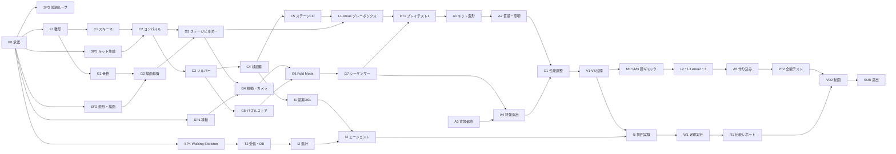

# 03 開発ロードマップ：タスク分解・スケジュール・Vertical Slice の完成判定

---

## 8. 開発タスクの分解

### 8.1 フェーズ構成の見直し

v0.1 では、ステージのデータ駆動化とプレイログ収集が Phase 3、自動化が Phase 4 に置かれていた。この順番だと、プレイデータを集められるのが最終盤になり、提出物に必要な「改善前後の比較」が作れない恐れがある。また、データ駆動化を後から行うと、手作りのステージをデータに移し替える二度手間が発生する。そこで v0.2 では、次の3点を変更した。

まず、ステージは最初からデータで定義する（Phase 1 の基盤に含める）。次に、デプロイ、ログ、定期的な LLM 実行、コミット、再デプロイを、中身のない最小構成で最初の週に一周させる（Walking Skeleton）。外部サービスの制約（Vercel のコミット作成者の制限、Supabase の権限、Actions の権限）は、このときに全て表に出る。最後に、Area 1 の Vertical Slice を完成した時点で公開し、データ収集を始める。AI パイプラインの本実装（Phase 3）は Area 2・3 の制作（Phase 2）と並行して進め、Area 1 のデータで改善実験を始める。

| フェーズ | 内容 | 目安の時期 |
|---|---|---|
| Phase 0 | 設計の承認、技術検証（Spike）、Walking Skeleton | 第1週 |
| Phase 1 | 基盤（core、描画、移動、ステージビルダー）、Area 1 グレーボックス、プレイテスト、作り込み、VS 公開 | 第2〜6週 |
| Phase 2 | ミラーシフト、ペンローズのループ、螺旋回廊、Area 2・3 | 第7〜11週 |
| Phase 3 | 提案DSL、集計、エージェント、初回の改善実験（Phase 2 と並行） | 第7〜9週 |
| Phase 4 | 定期実行の本番化、「学習する都市」の表示、改善サイクル、比較レポート、紹介動画、提出 | 第10〜13週 |

### 8.2 タスク一覧

規模は、Claude Code が実装の大部分を担う前提での、ユーザーの作業日数の目安である（指示、確認、調整、プレイテスト、アートの判断を含む）。コードの量よりも、操作感の調整と見た目の判断に時間がかかると見込んでいる。

**Phase 0**

| ID | タスク | 依存 | 規模 | 完了条件 |
|---|---|---|---|---|
| P0 | 設計の承認と確認事項の回答 | — | 0.5 | README の承認事項が決まる |
| SP1 | Spike：三人称の移動（Rapier のキャラクターコントローラ）とカメラ衝突を、グリッドの仮部品の上で試す | P0 | 1 | 階段、手すり、ブロッカー、狭い通路で破綻がない |
| SP2 | Spike：変形アニメーションと衝突体の確定、背景ビル5,000棟の折り畳み、WebGLRenderer と WebGPURenderer の実測比較 | P0 | 1.5 | 基準機で [02 §5.7](02_architecture.md) の予算に収まるかの実測値が出る |
| SP3 | Spike：ペンローズの周期ループの継ぎ目 | P0 | 0.5 | 録画をコマ送りしても継ぎ目で不連続が見えない |
| SP4 | Walking Skeleton：Vercel への CLI デプロイ、`/api/telemetry`、Postgres、定期ワークフロー、Claude Code による空の提案、コミット、再デプロイ | P0 | 1 | ループが一周し、ゲーム内の改訂番号が上がる |
| SP5 | Spike：Blender のヘッドレス実行で部品を生成し、GLB からポートを抽出して表示する | P0 | 1 | `kit.generated.json` が生成され、three.js で表示できる |

**Phase 1（Vertical Slice）**

| ID | タスク | 依存 | 規模 | 完了条件 |
|---|---|---|---|---|
| F1 | リポジトリの雛形（Vite 8、TypeScript 6.0、Biome、Vitest、Playwright、CI） | P0 | 0.25 | CI が通る |
| C1 | core：ステージスキーマ（Zod）と JSON Schema の出力 | F1 | 0.5 | 例のステージが検証を通る |
| C2 | core：キット定義の読み込みとコンパイル（姿勢、歩行セル、ポートの一致、領域） | C1, SP5 | 1 | 単体テストで接続が期待どおり |
| C3 | core：ソルバー（0-1 BFS、詰み検出、初手の追加手数）と指標 | C2 | 0.5 | 検証スクリプトと同じ結果を出す |
| C4 | core：検証器（S・G・L・Q のルールと意図契約） | C3 | 1 | 壊したステージを全て検出する |
| C5 | tools：ステージ CLI（validate、solve、上面図 SVG の出力） | C4 | 0.5 | CLI で結果と図が出る |
| G1 | game：アプリの骨格（固定タイムステップ、入力、イベントバス、設定） | F1 | 0.5 | 空のシーンが安定して動く |
| G2 | game：描画の基盤（トーンマッピング、環境マップ、ポストエフェクト、画質段階、解像度の自動調整） | G1, SP2 | 1 | 画質の切り替えが効く |
| G3 | game：ステージビルダー（キットからメッシュ、衝突体、手すり、ブロッカー、ゲート、可動グループを生成） | C2, G2 | 1.5 | 例のステージが表示され、歩ける |
| G4 | game：プレイヤーの移動とカメラ（衝突、遮蔽物の半透明化、カメラヒント） | G3, SP1 | 2 | 操作感のチェックリストを満たす |
| G5 | game：パズルストア、リセット、チェックポイント | C3, G1 | 0.5 | リセットで状態と位置が戻る |
| G6 | game：インタラクションと Fold Mode（プレビュー、干渉の表示、接続の光） | G4, G5 | 1.5 | 初見の人がプレビューの意味を理解できる |
| G7 | game：変形シーケンサーと演出カメラ | G6 | 2 | 連鎖変形が予定の時間軸で再生される |
| G8 | game：ヒント、詰み検出、パーの表示 | G5, C3 | 0.5 | ソルバーの次の一手が表示される |
| G9 | game：UI（タイトル、告知、ポーズ、設定、操作表示、クリア画面） | G1 | 1 | 全画面が日本語・英語で表示される |
| G10 | game：音（環境音、変形の効果音、UI 音） | G7 | 1 | 変形と音が同期する |
| T1 | テレメトリの送信（購読、バッチ、sendBeacon、同意の設定） | G1, SP4 | 0.5 | 全イベントが送られる |
| T2 | テレメトリの受信と DB（関数、検証、マイグレーション、集計ビュー） | SP4 | 0.5 | 集計ビューで数値が見える |
| L1 | Area 1 のグレーボックス（1-1〜1-3 のデータ、意図契約、スロット） | C5, G3 | 1.5 | 検証器が合格し、通しで遊べる |
| PT1 | プレイテスト1（グレーボックス、3〜5人）と修正 | L1, G6, G7, G8 | 1.5 | 理解と面白さの問題点が洗い出され、直っている |
| A1 | キット v1 の造形（道路、階段、手すり、立方体、塔、街路、コンソール） | SP5, L1 | 4 | グレーボックスを全て置き換えられる |
| A2 | マテリアル、トリムシート、HDRI、ライティング | G2, A1 | 1.5 | 基準スクリーンショットの画作りが決まる |
| A3 | 背景都市の生成、折り畳みシェーダー、空の都市 | SP2, G2 | 1.5 | 波のような折り畳みが予算内で動く |
| A4 | Area 1 終盤の演出シーケンス | G7, A3 | 1.5 | 街路が倒れてから門が開くまでが通しで再生される |
| O1 | 性能の調整（予算の確認、事前コンパイル、LOD） | A1, A2, A3, A4 | 1 | [02 §5.7](02_architecture.md) を満たす |
| V1 | VS の判定、公開、プレイテスト2 | 上記すべて | 1 | §9.3 の基準を満たす |

**Phase 2（ゲーム完成版）**

| ID | タスク | 依存 | 規模 | 完了条件 |
|---|---|---|---|---|
| M1 | ミラーシフト（層、ミラー領域、レンズ、遷移の演出） | G6 | 2 | 学習ビートが成立する |
| M2 | ペンローズのループ部品（周期的な幾何、継ぎ目、周回カウンタ、遠景レイヤー） | SP3, G3 | 1.5 | 継ぎ目が知覚されない |
| M3 | 螺旋回廊の部品（手続き生成のメッシュ、衝突体、踊り場のゲート） | G3 | 1.5 | パラメータから歩ける回廊が生成される |
| L2 | Area 2 の設計とグレーボックス（ソルバーで配置を探索） | M3, C5 | 2 | 意図契約を満たす配置が決まる |
| L3 | Area 3 の設計とグレーボックス | M1, M2, C5 | 2 | 同上 |
| A5 | Area 2・3 の作り込み（造形、演出） | L2, L3 | 4 | 全編の見た目が揃う |
| G11 | エリア間の遷移、裏での読み込み、進捗表示 | G3 | 1 | 待ち時間なしでエリアが切り替わる |
| PX1 | 物理検証 P1（最短解の経路をヘッドレスの Rapier で歩く） | C4, G4 | 1 | CI に組み込まれる |
| PT2 | プレイテスト3（全編） | A5, G11 | 1.5 | 全編で §9.3 と同等の基準を満たす |

**Phase 3（LLM 連携）**

| ID | タスク | 依存 | 規模 | 完了条件 |
|---|---|---|---|---|
| I1 | 提案 DSL、適用スクリプト、`ai:check` | C4 | 1 | 不正な提案を全て却下する |
| I2 | 集計ビューと `metrics.json` の生成（信頼区間、初手の分布） | T2 | 1 | 実データで指標が出る |
| I3 | 自由記述の隔離分類器 | I2 | 0.5 | 指示文を含む入力でもラベルしか出ない |
| I4 | エージェントのプロンプト、権限設定、乾式実行 | I1, I2, I3 | 1 | 乾式実行で妥当な提案が出る |
| I5 | 初回の改善実験（手動起動） | I4, V1 | 0.5 | 1件の改善が本番に反映される |

**Phase 4（自動化・公開・提出）**

| ID | タスク | 依存 | 規模 | 完了条件 |
|---|---|---|---|---|
| W1 | 定期ワークフローの本番化（ゲート、適用、デプロイ、ロールバック、改善記録） | I4, SP4 | 1 | 無人で1週間動く |
| W2 | 「学習する都市」の表示（改訂番号、改善記録の閲覧） | W1 | 0.5 | タイトル画面に表示される |
| W3 | Extra モード（Tier 2 の生成と検証）※任意 | I1, W1 | 2 | 生成された部屋が検証を通って公開される |
| R1 | 改善前後の比較レポートの生成（グラフ、ヒートマップ） | I2 | 1 | 動画に使える図が出る |
| VD1 | 動画用のキャプチャ（決定的リプレイ、オフラインのフレーム出力、ffmpeg） | G7 | 1 | 4K60 の素材が書き出せる |
| VD2 | 紹介動画の構成、撮影、編集 | VD1, R1 | 2.5 | manaba の仕様を満たす動画 |
| SUB | 提出 | 上記すべて | 0.5 | 提出完了 |

規模の合計は、Phase 0 が約5.5日、Phase 1 が約30日、Phase 2 が約16.5日、Phase 3 が約4日、Phase 4 が約8.5日（Extra モードを含む）で、全体で約64日になる。週5日作業できれば約13週、週3日なら約21週かかる計算である。v0.1 の全範囲は、ほぼ専念できる場合に初めて収まる規模であり、作業可能な日数によっては §8.4 のスコープの階層に沿って削る必要がある。

### 8.3 依存関係とクリティカルパス

クリティカルパスは、承認、キット生成の検証、コンパイル、ステージビルダー、移動とカメラ、Fold Mode、シーケンサー、Area 1 のグレーボックス、プレイテスト1、キットの造形、性能調整、VS の公開と続き、そこから Area 2・3 の制作、全編のテスト、動画、提出に至る経路である。AI の経路（Walking Skeleton、受信と DB、集計、エージェント、定期実行）は最初の週に骨組みができているので、クリティカルパスには乗らない。ただし、改善前後の比較には VS 公開後の実データが必要なので、VS の公開日が遅れると、そのまま改善サイクルの回数が減る。

### 8.4 スケジュール案とスコープの階層

承認が 2026-11-02 の週に得られ、週5日程度作業できると仮定した日程は次のとおり。

| 週 | 期間（目安） | 主な内容 | 節目 |
|---|---|---|---|
| 1 | 11/02〜11/06 | Phase 0（Spike 5本、Walking Skeleton） | ループが一周する |
| 2〜3 | 11/09〜11/20 | core、描画基盤、移動、Fold Mode、Area 1 グレーボックス | プレイテスト1 |
| 4〜6 | 11/23〜12/11 | キットの造形、質感、背景都市、終盤の演出、性能調整 | VS 公開、データ収集の開始 |
| 7〜9 | 12/14〜01/08 | ミラーシフト、ペンローズ、螺旋、Area 2・3 グレーボックス。並行して AI パイプライン | 初回の改善実験 |
| 10〜11 | 01/11〜01/22 | Area 2・3 の作り込み、全編の公開、改善サイクル | 全編のプレイテスト |
| 12〜13 | 01/25〜02/05 | 改善サイクルの継続、比較レポート、紹介動画 | 提出 |

締切がこれより早い場合や、週に作業できる日数が少ない場合は、次の階層に沿って下位から削る。

| 階層 | 内容 | 理由 |
|---|---|---|
| Must | Area 1（VS 品質）、テレメトリ、自動デプロイ、AI ループ（Tier 0・1）、改善前後の比較、紹介動画 | 授業要件（C1〜C6）を満たす最小構成 |
| Should | Area 3（ミラーシフトとペンローズのループ）、「学習する都市」の表示 | 作品の看板である不可能建築を見せる |
| Could | Area 2（螺旋回廊のパズル）、Extra モード（Tier 2）、フォトモード、カスケードシャドウなどの高画質機能 | 無くても作品と要件が成立する |

Area 2 と Area 3 のどちらかを削る場合は、Area 2 を螺旋回廊を登るだけの短いつなぎ（パズルなし）に縮め、Area 3 を残すことを推奨する。ペンローズの階段の方が作品の独自性への寄与が大きく、ミラーシフトという2つ目の能力も Area 3 にあるからである。

---

## 9. Vertical Slice の実装計画と完成判定基準

### 9.1 範囲

VS の範囲は、タイトル画面（データ収集の告知を含む）、Area 1 の3セクションと終盤の演出、パーを表示するクリア画面、ポーズと設定（感度、上下反転、FOV、演出の軽減、画質、言語、データ送信の停止）、チェックポイントとリセット、プレビュー付きの Fold Mode、2段階のヒント、音、テレメトリの送受信、GitHub Actions からの本番デプロイである。ミラーシフト、ペンローズのループ、螺旋回廊、Extra モード、フォトモードは含めない。AI ループは Phase 0 の Walking Skeleton の状態（空の提案が一周する）までを含める。

### 9.2 実装の進め方

最初に `core`（スキーマ、コンパイル、ソルバー、検証器）を書き、[検証スクリプト](verification/README.md)と同じ結果が出ることを単体テストで確かめる。並行してブラウザ側の骨格と描画の基盤を作り、ステージビルダーでキットの仮部品からシーンを組み立てる。移動とカメラは SP1 の結果を引き継ぎ、Area 1 のグレーボックスを歩き回れる状態にする。

次に Fold Mode とシーケンサーを入れ、Area 1 をグレーボックスのまま通しで遊べるようにして、プレイテスト1を行う。この時点で、プレビューの分かりやすさ、カメラ、パズルの難しさ、変形のテンポを直す。見た目の作り込みは、プレイテスト1で遊びの手応えを確認してから始める。遊びが固まる前に造形に時間を使うと、配置の変更に追従できず作り直しになるためである。

作り込みの段階では、キットの造形、トリムシートと照明、背景都市、終盤の演出を並行して進め、最後に性能を基準機で調整する。完成判定（§9.3）を満たしたら公開し、プレイテスト2を行い、そのままデータ収集を始める。

### 9.3 完成判定基準

| 観点 | 基準 | 確かめ方 |
|---|---|---|
| 遊べる | 公開URLでタイトルから Area 1 のクリアまで通しで遊べる。10回連続の通しプレイで進行不能のバグがない | 手動テストと E2E のスモークテスト |
| 分かる | 初見の5人以上のうち4人以上が、口頭の助けなしにクリアできる。所要時間の中央値が2.5〜5分 | プレイテスト（画面録画） |
| 詰まない | テレメトリで検出された詰み状態が0。検証器の L3 が0 | テレメトリと CI |
| 面白い | アンケートの「面白さ」の中央値が5段階で4以上。印象に残った場面として変形を挙げる人が過半数 | アンケート |
| 美しい | 「映像の印象」の中央値が4以上。基準スクリーンショット3枚がアートディレクションを満たす（ユーザーが判定） | アンケートとレビュー |
| 速い | 基準機の Medium 画質で、p95 フレーム時間がゲーム中20 ms以下・演出中33 ms以下。変形の開始時に100 msを超える停止がない。初回ロードが50 Mbpsで10秒以内、転送量25 MB以下 | perf テレメトリと計測 |
| データ駆動 | Area 1 の全内容が `stage.json` とキットで定義されている。スロットの選択肢を変えると、コードを変えずにゲームに反映される | 実演 |
| 検証 | CI で S・G・L・Q の全ルールが合格する | CI |
| 計測 | テスト用セッションの95%以上で、全イベントがビルドIDとステージの版付きで DB に届く。個人を特定できる情報を含まない | DB への問い合わせ |
| 配慮 | 演出の軽減設定が全シーケンスに効く。感度、上下反転、FOV を設定できる。どこでもポーズできる | チェックリスト |
| 品質 | 型チェック、Lint、単体テストが CI で合格する。ソルバーと検証器の主要ルールにテストがある | CI |

### 9.4 プレイテストの進め方

参加者は5〜8人とし、ゲームを初めて遊ぶ人を優先する。説明はタイトル画面に書かれている内容だけにして、口頭では操作方法も教えない。画面と声を録画し、詰まった場所、Fold Mode を開いてから確定するまでの時間、プレビューを見た後に別の状態を選び直した回数を記録する。終了後に5段階の評価（面白さ、難しさ、分かりやすさ、映像の印象）と自由記述のアンケートを取る。プレイテストのセッションも本番と同じテレメトリで記録するが、本番データとは区別できるように `?playtest=1` の印を付ける。

### 9.5 VS 後の判断

VS の判定では、「分かる」と「面白い」の基準を最も重く見る。満たさない場合は、Area 2・3 に進む前に、Area 1 のパズルと Fold Mode の改善に最大1週間を使う。土台の遊びが成立していないまま内容を増やすと、全てのエリアで同じ問題を抱えることになるからである。性能の基準を満たさない場合は、[02 §5.7](02_architecture.md) の画質段階と演出の量で調整する。データ収集とデプロイの経路に問題がある場合は、内容の制作より先に直す。

---

## 10. 承認後の最初の1週間

承認を受けたら、最初の2日で SP4（Walking Skeleton）と SP5（キット生成）を進め、外部サービスとアセットパイプラインという、後から変えにくい部分の前提を確かめる。Vercel へのデプロイ経路、Supabase のロールと GRANT、Actions の権限、Claude Code の非対話実行の認証は、ここで全て実際に動かして確認する。残りの3日で SP1〜SP3（移動、変形と描画、周期ループ）を行い、描画バックエンドを WebGLRenderer のままにするか、WebGPURenderer に切り替えるかを実測値で決める。週の終わりに Spike の結果をまとめ、この設計書の該当箇所を更新したうえで、Phase 1 に入る。
